<!-- Generated by brand/scripts/book.py from guidelines/chapters/. Edit the chapters. -->

# Phần 1 · Thương hiệu

<div class="cover-note">Living Zen — Brand Guidelines 2.0 · Hương Thiền Nature · phát hành 26/11/2026. Phiên bản thương hiệu (Living Zen 2.0) được quản lý độc lập với số phiên bản phần mềm website.</div>

## 1. Giới thiệu thương hiệu

Hương Thiền Nature là một hệ sinh thái học tập, thực hành và nuôi dưỡng đời sống tỉnh thức, kết nối con người với chính mình, với thiên nhiên và với cộng đồng.

Hệ sinh thái đứng trên ba trọng tâm do người sáng lập mô tả: **pháp môn tu tập** (thiền, chánh niệm, yoga), **môi trường thiên nhiên từ các farm đối tác**, và **môi trường thực hành, sách vở, đá thanh lọc**. Những người đồng hành xung quanh (farm Lê Lam Sơn, đối tác đá năng lượng, ZenWork phụ trách công nghệ và truyền thông) bổ trợ để ba trọng tâm phát triển hài hòa và bền vững.

Thương hiệu **không** định vị mình là một tổ chức tâm linh huyền bí, một đơn vị chỉ bán khóa học, hay một thương hiệu thương mại thiên nhiên đơn lẻ.

## 2. Câu chuyện thương hiệu

Đỗ Thị Kim Hương, thường gọi là Hương Thiền, lớn lên ở Quảng Nam và quen tự lo cho mình từ sớm. Khi có thời gian ngồi yên, chị nhận ra có những ngày điều mình cần nhất là thừa nhận mình đã mỏi và cho phép mình nghỉ một lát. Từ chỗ ngồi ấy, sự chú tâm theo chị ra khỏi phòng: đến bữa cơm, những bước chân ngoài vườn và cách lắng nghe một người. Hương Thiền Nature là nơi chia sẻ cách đem thiền định và chánh niệm vào những việc bình thường như thế. Kiều Mạnh đồng sáng lập, viết, biên tập và phụ trách truyền thông.

*(Tóm lược từ trang Câu chuyện và Trang chủ của website; không thêm chi tiết mới.)*

## 3. Tầm nhìn

> Một cộng đồng nơi mỗi người có thể sống tỉnh thức, lành mạnh và phụng sự, với gốc rễ trong đất, khoảng lặng trong tâm và ánh sáng trong trí.

*Đề xuất dựa trên lời kết của trang Hệ sinh thái ("Một cuộc sống tỉnh thức, lành mạnh và phụng sự") và định hướng "Dưỡng Thân · An Tâm · Sáng Trí". Chờ chủ dự án xác nhận câu chữ cuối cùng.*

## 4. Sứ mệnh

> Đưa thiền định, chánh niệm và lối sống thuận tự nhiên vào những việc bình thường mỗi ngày, bằng nội dung tử tế, thực hành giản dị và những người đồng hành thật.

*Đề xuất, chờ xác nhận.*

## 5. Giá trị cốt lõi

| Giá trị | Nghĩa là | Thể hiện trong thiết kế |
|---|---|---|
| Có gốc rễ trong đất | Thân khỏe, sống chậm, gần thiên nhiên | Xanh rừng, đất nung, giấy mộc, họa tiết tầng đất |
| Có khoảng lặng trong tâm | Trở về, lắng nghe, dịu dàng với mình | Khoảng trắng rộng, tím lan, nhịp thở 4s/6s |
| Có ánh sáng trong trí | Hiểu sâu, nhận biết, sống sáng suốt | Vàng kim dùng tiết chế, chữ dễ đọc, thông tin rõ |
| Trung thực | Phân biệt khoa học, giáo lý, trải nghiệm và niềm tin | Không hứa chữa bệnh, không gây sợ hãi |
| Phụng sự | Lan tỏa vì cộng đồng | Quỹ ủng hộ, nội dung miễn phí, ngôn ngữ không áp lực |

Mọi quyết định thiết kế phải phản ánh được ít nhất một trong ba phẩm chất đầu.


# Phần 2 · Chiến lược Living Zen

## 6. Brand Essence

**Từ thiên nhiên, trở về với chính mình.** Hương Thiền Nature là chỗ giao nhau của thiền định, chánh niệm, trí tuệ phương Đông, tâm lý học ứng dụng, tình yêu thương, sống thuận tự nhiên, nông nghiệp và hệ sinh thái, dinh dưỡng và ẩm thực chay, công nghệ phục vụ con người, và tinh thần phụng sự.

## 7. Brand Personality

| Phẩm chất | Nhưng không | Ví dụ áp dụng |
|---|---|---|
| Mộc mạc | sơ sài | Giấy mộc, đường nét tay, nhưng căn lề và lưới chặt chẽ |
| Sâu sắc | khó hiểu | Câu ngắn, ví dụ đời thường, chú giải thuật ngữ |
| Tâm linh | mê tín | Tarot, "tần số" luôn được nói là chiêm nghiệm, ẩn dụ |
| Tinh tế | xa cách | Xưng "mình / tụi mình / bạn" |
| Dịu dàng | yếu đuối | Màu ấm nhưng tương phản đủ, nút bấm rõ ràng |
| Hiện đại | lạnh lùng | Giao diện sạch, có hình minh họa thực vật |
| Tĩnh lặng | thiếu sức sống | Chuyển động chậm, có chủ đích, không đứng yên tuyệt đối |
| Có trí tuệ | phô trương | Không khoe chứng chỉ, nguồn tham khảo rõ |

## 8. Brand Archetype

Sage — Người mang trí tuệ (45%) · Caregiver — Người nuôi dưỡng (35%) · Explorer — Người khám phá (20%).
Đây là tỷ lệ định hướng sáng tạo, không phải kết quả khảo sát. Thương hiệu không đóng vai người nắm giữ chân lý tuyệt đối: người hướng dẫn là bạn đồng hành đi trước một đoạn.

## 9. Brand Voice

**Gần gũi, bao dung, chân thành, có chiều sâu, đôi khi hài hước nhẹ.** Ưu tiên "mình", "tụi mình", "bạn".

| Nên | Không nên |
|---|---|
| "Không cần phải ổn, không cần biết thiền." | "Bạn đang sống sai cách." |
| "Một phút cũng là một khởi đầu." | "Chỉ còn 3 suất, đăng ký ngay!" |
| "Nghiên cứu năm 2019 đo được… Phần còn lại là chiêm nghiệm." | "Thiền chữa khỏi mất ngủ." |
| "Đá là người bạn đồng hành khi thực hành." | "Đá thanh tẩy năng lượng xấu, bảo vệ sức khỏe." |

Không dùng ngôn ngữ gây sợ hãi, áp đặt niềm tin, phán xét người chưa thực hành, hứa chữa bệnh, khẳng định chuyển hóa siêu nhiên, thương mại hóa sự dễ tổn thương hay gây áp lực mua. Luôn tách bạch bốn tầng: **khoa học đã đo**, **giáo lý**, **trải nghiệm cá nhân**, **niềm tin tâm linh**.

## 10. Slogan và thông điệp

| Vai trò | Tiếng Việt | English | Khi dùng |
|---|---|---|---|
| Tagline chính | Từ thiên nhiên, trở về với chính mình. | Rooted in Nature. Awakened Within. | Logo lockup chiến dịch, bìa, đầu trang giới thiệu |
| Lời chào trang chủ | Có mặt trong đời mình. | Be present for your own life. | Hero website, story mạng xã hội |
| Chiến dịch cộng đồng | Gieo hạt tỉnh thức, nuôi dưỡng yêu thương. | — | Quỹ ủng hộ, sự kiện, túi vải |
| Lối sống | Sống sâu sắc, sống giản dị, sống thuận tự nhiên. | — | Ấn phẩm, cửa hàng |
| Trích dẫn | Mỗi ngày là một cơ hội để bắt đầu lại. · Trí tuệ lớn lên từ những điều giản dị. | — | Thẻ trích dẫn, trang sách |

Quy tắc: mỗi ấn phẩm dùng **một** thông điệp. Tagline chính không đặt cạnh câu trích dẫn.


# Phần 3 · Triết lý thiết kế và Logo

## 11. Triết lý thiết kế Living Zen

Mộc mạc như đất · tràn đầy sức sống như cây · dịu dàng như một người bạn · tĩnh lặng như một thiền sinh · sáng suốt như ánh bình minh.

Ba nguyên tắc thực hành: **khoảng trắng là một phần của thiết kế** (không lấp mọi chỗ trống bằng họa tiết); **mỗi màn hình một điểm nhấn** (không biến mọi nút thành gradient); **chuyển động để nâng đỡ, không để gây chú ý**.

## 12. Ba phương án logo

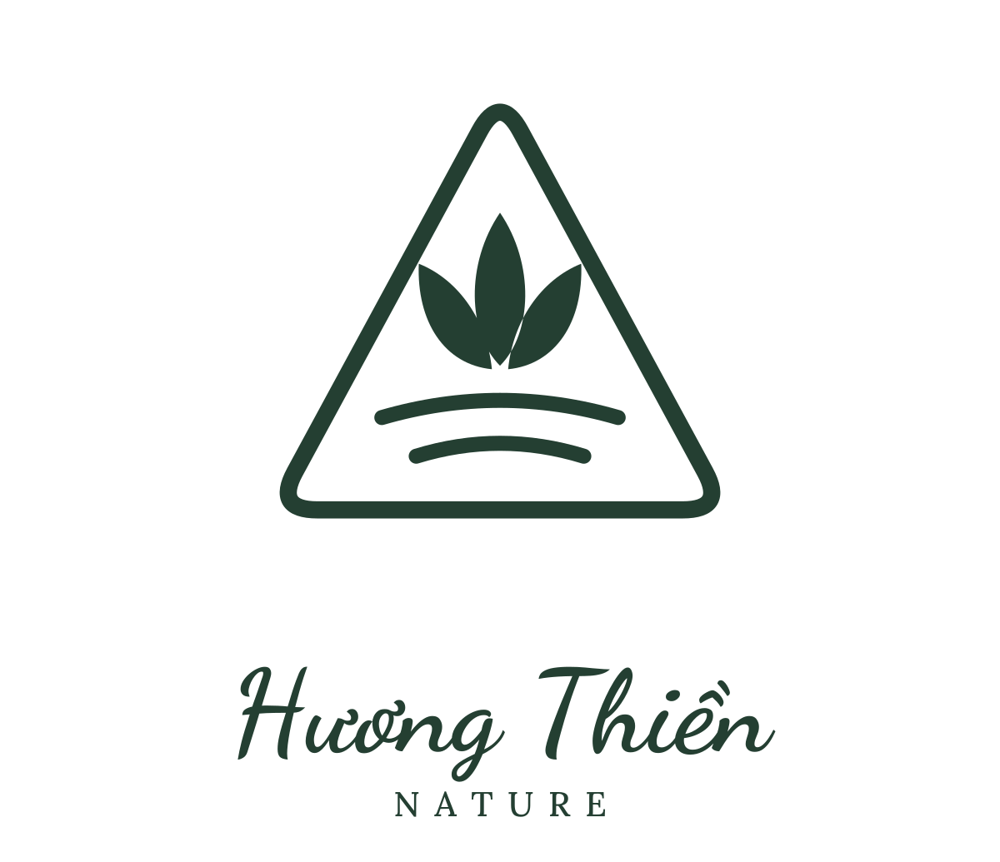{.third} 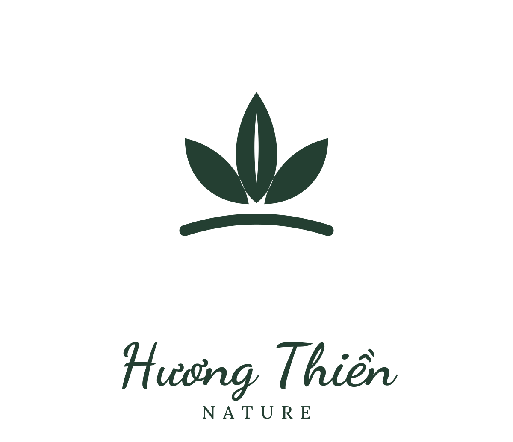{.third} 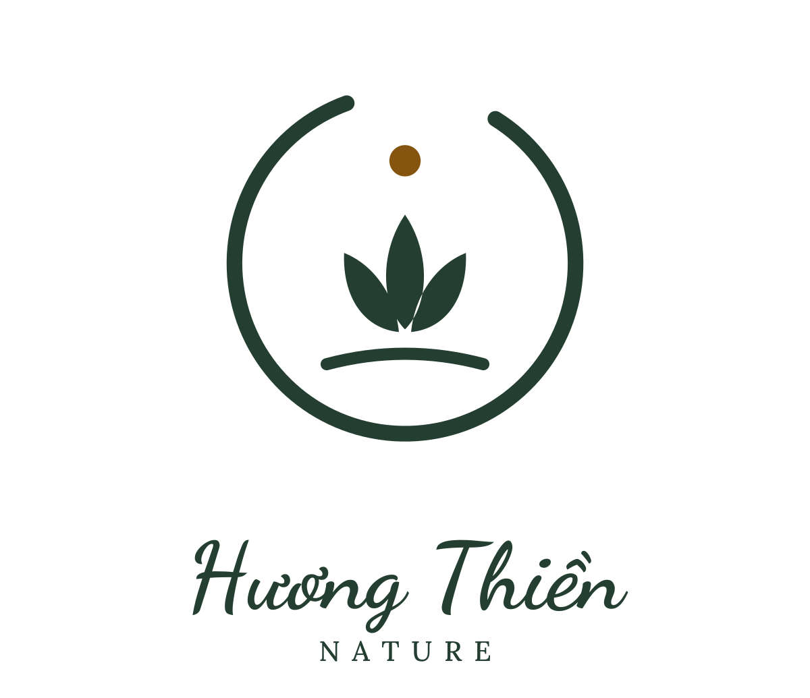{.third}

| Tiêu chí (trọng số) | A · Living Roots | B · Zen Essence | C · Inner Light |
|---|---:|---:|---:|
| Kế thừa bản sắc (25%) | 5 | 3 | 2 |
| Khả năng ghi nhớ (20%) | 4 | 4 | 4 |
| Khả năng thu nhỏ (20%) | 4 | 5 | 3 |
| Tính khác biệt (15%) | 4 | 3 | 4 |
| Ứng dụng đa nền tảng (10%) | 4 | 5 | 3 |
| Thẩm mỹ lâu dài (10%) | 5 | 4 | 4 |
| **Tổng** | **4,35** | **3,90** | **3,20** |

**A · Living Roots** giữ tam giác bo tròn, hoa sen và đường đất của logo gốc nhưng vẽ lại bằng hình học sạch: tam giác (Thân – Tâm – Trí; Giới – Định – Tuệ như lớp liên tưởng bổ sung), ba cánh sen (tỉnh thức, trưởng thành nội tâm), hai đường đất (đất đai, mùa màng, vòng tuần hoàn). Chiếc lá nhỏ của logo gốc được gộp vào hai cánh bên để mark đọc được ở 32 px.
**B · Zen Essence** gộp sen và lá thành một hình; gọn nhất ở cỡ nhỏ nhưng mất tam giác nhận diện.
**C · Inner Light** dùng vòng ensō mở và một chấm sáng; sâu lắng, hợp không gian thiền nhưng xa logo hiện tại nhất.

**Đề xuất: A.** Logo trên website **chưa được thay**; chờ chủ dự án duyệt. Các lớp ý nghĩa trên là đề xuất sáng tạo, không phải ý nghĩa lịch sử đã được người sáng lập xác nhận.

## 13. Logo chính thức sau khi được duyệt

Khi phương án được duyệt: thay `public/media/huong-thien-logo-*.webp`, favicon, apple-touch-icon, android icons và `site.webmanifest` bằng tệp trong `brand/logos/` (xem quy trình ở mục 42). Đến lúc đó, các tệp trong thư mục này mang trạng thái **ĐỀ XUẤT**.

## 14. Logo construction

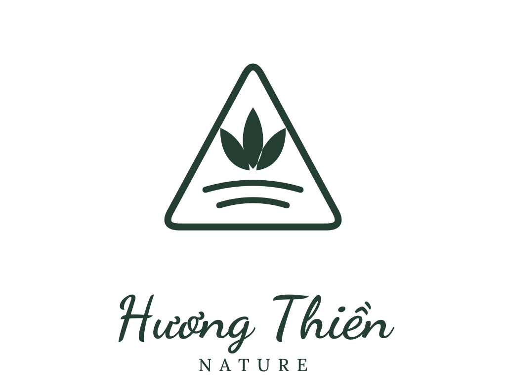{.half}

- Lưới 512 × 512. Tam giác: đỉnh (256, 52), (46, 440), (466, 440), bo góc 40, nét 16.
- Sen: ba cánh đối xứng qua trục x = 256, gốc tại y = 307, phóng 1,08.
- Đất: hai đường cong bậc hai, nét 14, đầu tròn.
- Chữ: "Hương Thiền" Dancing Script 700 đã chuyển thành vector; "NATURE" Lora 500, giãn chữ 0,42 em, cao bằng 30% chữ trên.
- Mọi tệp master là SVG thuần vector: không ảnh bitmap, không texture, không bóng, không phát sáng, không watermark.

## 15. Responsive Logo System

| Biến thể | Tệp | Dùng khi |
|---|---|---|
| Primary (dọc, đầy đủ) | `logos/primary/` | Bìa, trang giới thiệu, bảng hiệu đứng |
| Horizontal | `logos/horizontal/` | Header, chữ ký email, slide, danh thiếp |
| Vertical | `logos/vertical/` | Tem nhãn, mạng xã hội vuông |
| Compact (mark + "Hương Thiền") | `logos/compact/` | Không gian hẹp |
| Brand mark | `logos/brand-mark/` | Avatar, watermark, bao bì nhỏ |
| Wordmark | `logos/wordmark/` | Khi mark đã xuất hiện gần đó |
| Monochrome | `logos/monochrome/` | In một màu, khắc laser, dập nổi, thêu, in lụa |
| Reversed | `logos/reversed/` | Nền xanh rừng, nền tím đêm |
| Favicon | `logos/favicon/` | Tab trình duyệt (bản 16 px riêng) |
| App icon, maskable | `logos/app-icons/` | Điện thoại, PWA |
| Watermark | `logos/watermark/` | Ảnh, video (độ mờ 14–18%) |
| Co-branding | `logos/co-branding/` | Cùng đối tác |

Màu: Forest (mặc định), Orchid, Golden Light (chỉ trên nền tối hoặc ngữ cảnh đặc biệt), Trắng ngà, Đen, Trắng.

## 16. Clear space

Khoảng trống tối thiểu quanh logo = **chiều cao hai cánh sen bên** (≈ 18% chiều cao mark). Không đặt chữ, ảnh hay mép giấy vào vùng này.

## 17. Minimum size

| Biến thể | Màn hình | In |
|---|---|---|
| Brand mark | 24 px (dưới 24 px dùng favicon 16) | 6 mm |
| Horizontal | 120 px rộng | 30 mm rộng |
| Primary | 160 px rộng | 35 mm rộng |

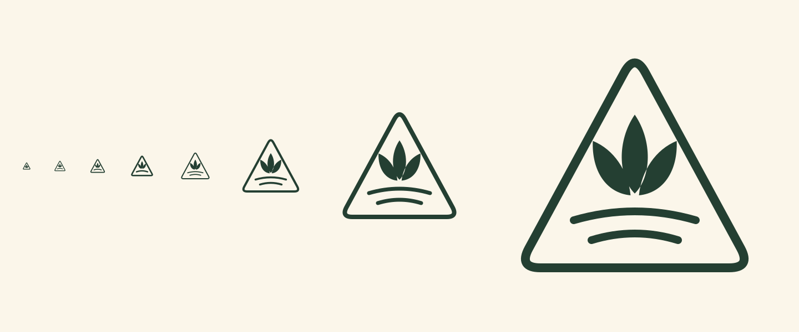

Đã kiểm ở 16, 24, 32, 48, 64, 128, 256, 512 px: 16 px dùng bản chỉ có tam giác + sen; 24–48 px dùng bản một đường đất, nét dày hơn.

## 18. Logo usage

Ưu tiên logo xanh rừng trên giấy mộc hoặc trắng; trắng ngà trên xanh rừng; vàng kim trên tím đêm. Trên ảnh: đặt ở vùng ảnh phẳng, độ tương phản ≥ 3:1 với nền; nếu ảnh nhiều chi tiết, dùng nền phẳng mờ 80% phía sau.

## 19. Logo misuse

Không: kéo giãn, xoay, đổi tỷ lệ mark và chữ, thêm bóng/phát sáng, đặt gradient lên chữ, dùng vàng kim trên nền sáng, đổi font chữ "Hương Thiền", đặt logo trên ảnh rối, dùng lại bản bitmap có texture giấy cũ, thêm khẩu hiệu vào trong vùng clear space.


# Phần 4 · Màu sắc và Chữ

## 20. Primary Color Palette

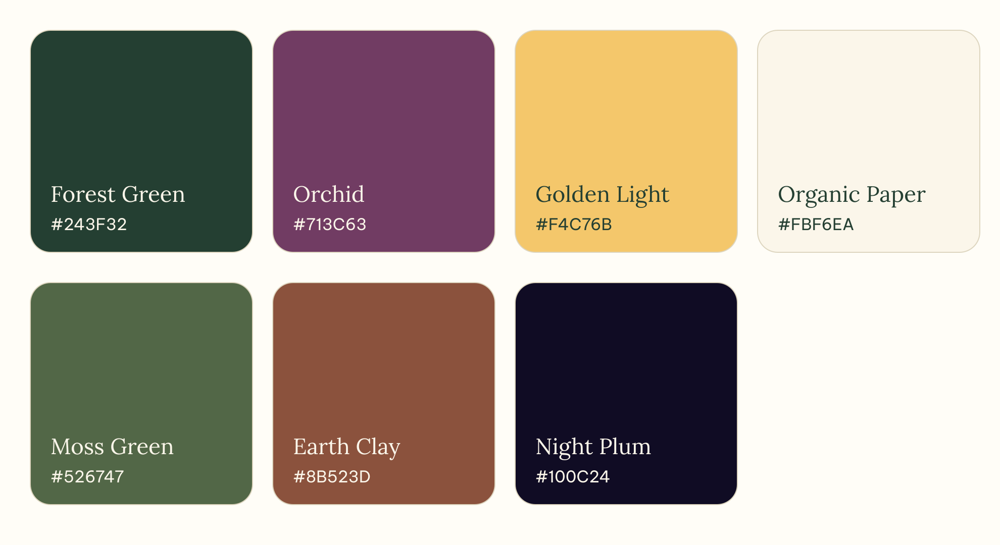

| Màu | HEX | RGB | Vai trò |
|---|---|---|---|
| Forest Green · Xanh rừng | `#243F32` | 36, 63, 50 | Màu nhận diện chính: logo, điều hướng, nút chính ban ngày, footer ban ngày |
| Orchid · Tím lan | `#713C63` | 113, 60, 99 | Tiêu đề cảm xúc, trích dẫn, nội dung thiền và nội tâm |
| Golden Light · Vàng kim | `#F4C76B` | 244, 199, 107 | Điểm nhấn có chủ đích; **không dùng cho chữ trên nền sáng** |

## 21. Secondary Color Palette

| Màu | HEX | Vai trò |
|---|---|---|
| Organic Paper · Giấy mộc | `#FBF6EA` | Nền đọc, nền mặc định |
| Moss Green · Xanh rêu | `#526747` | Thiên nhiên, thực hành, không gian THÂN |
| Earth Clay · Đất nung | `#8B523D` | Đất, dinh dưỡng, cửa hàng |
| Night Plum · Tím đêm | `#100C24` | Ban đêm, Tần Số Vàng |

## 22. Extended Color Palette

Forest Hover `#365544` · Leaf `#536C4C` · Soft Ink `#586557` · Warm Cream `#F6EED9` · Herbal Cream `#F3EBD4` · Raised Paper `#FFFDF7` · Sand `#DDD5BF` · Rice Gold `#EFE0B8` · Deep Orchid `#492742` · Orchid Mist `#F1E4EE` · Orchid Line `#CDB1C7` · Golden Highlight `#FFE7A8` · Golden Deep `#C88A2C` · Golden Accent `#855510` · Golden Wash `#FBF2DD` · Golden Ink `#1A1233` · Plum Deep `#1A1338` · Cosmic Plum `#2C1F50` · Night Orchid `#EDB9DD`.

**Màu ngữ nghĩa** (luôn kèm icon và chữ, không truyền tải thông tin chỉ bằng màu): Success `#2B5741`/`#E1F0E5` · Warning `#6B4C22`/`#F3E8CE` · Error `#7C392C`/`#F4E5DF` · Info `#2F4F63`/`#E3EDF2`. Focus: viền 2 px màu `--focus`, cách 3 px. Disabled: độ mờ 55%, không đổi màu.

Không tạo thêm màu gần giống nhau. Màu mới đi qua quy trình ở mục 42.

## 23. Color proportion

Giao diện ban ngày của thương hiệu mẹ (định hướng, không phải luật từng màn hình): **55%** giấy mộc và nền trung tính · **25%** xanh rừng và nhóm xanh · **10%** tím lan · **5%** đất nung · **5%** vàng kim.
Không gian riêng (Tần Số Vàng, Tarot) được dùng tỷ lệ khác nhưng vẫn giữ logo, chữ và lưới của thương hiệu mẹ.

### Quy tắc vàng kim

Primary action thông thường: **xanh rừng**. Secondary: **nền kem**. Tertiary: **liên kết chữ**. Special: **vàng kim** (`.button--special`), chỉ khi thật sự đặc biệt. Gradient chỉ ở khu vực truyền thông đặc biệt. Không mặc định gạch vàng dưới tiêu đề, nền vàng cho thẻ hay viền phát sáng.

## 24. Color combinations

| Không gian | Màu chính | Cảm giác |
|---|---|---|
| Thương hiệu mẹ | Forest + Paper + Orchid + Golden Light | Ổn định, gần gũi |
| THÂN | Moss, Forest, Earth Clay, Warm Cream | Đất, nuôi dưỡng |
| TÂM | Orchid, Orchid Mist, Deep Orchid, Paper | Riêng tư, dịu dàng |
| TRÍ | Paper, Golden Accent, Forest, Golden Light | Sáng rõ, học hỏi |
| Tần Số Vàng | Night Plum, Cosmic Plum, Golden Light, Golden Highlight | Tĩnh, sâu |
| Tarot tâm lý | Deep Orchid, Orchid, Orchid Line, Golden Light | Riêng tư, không huyền bí quá mức |
| Cửa hàng | Forest, Moss, Paper, Earth Clay | Chân thực, minh bạch |
| Quỹ & cộng đồng | Moss, Paper, Rice Gold, Golden Accent | Hợp tác, phụng sự |

## 25. Accessibility contrast

Xem bảng đầy đủ: `accessibility/contrast-tokens.md`. Tóm tắt: Forest/Paper 10,63:1 · Orchid/Paper 7,70:1 · Soft Ink/Paper 5,70:1 · Golden Accent/Paper 5,89:1 · Golden Highlight/Night 15,68:1 — đều đạt AA chữ thường. **Cấm**: Golden Light/Paper 1,47:1, Golden Deep/Paper 2,73:1 cho chữ.
Kết quả token không chứng minh cả website đạt chuẩn; giao diện thật được kiểm bằng axe sau khi render (mục 25 trong `accessibility/README.md`).

## 26. Typography

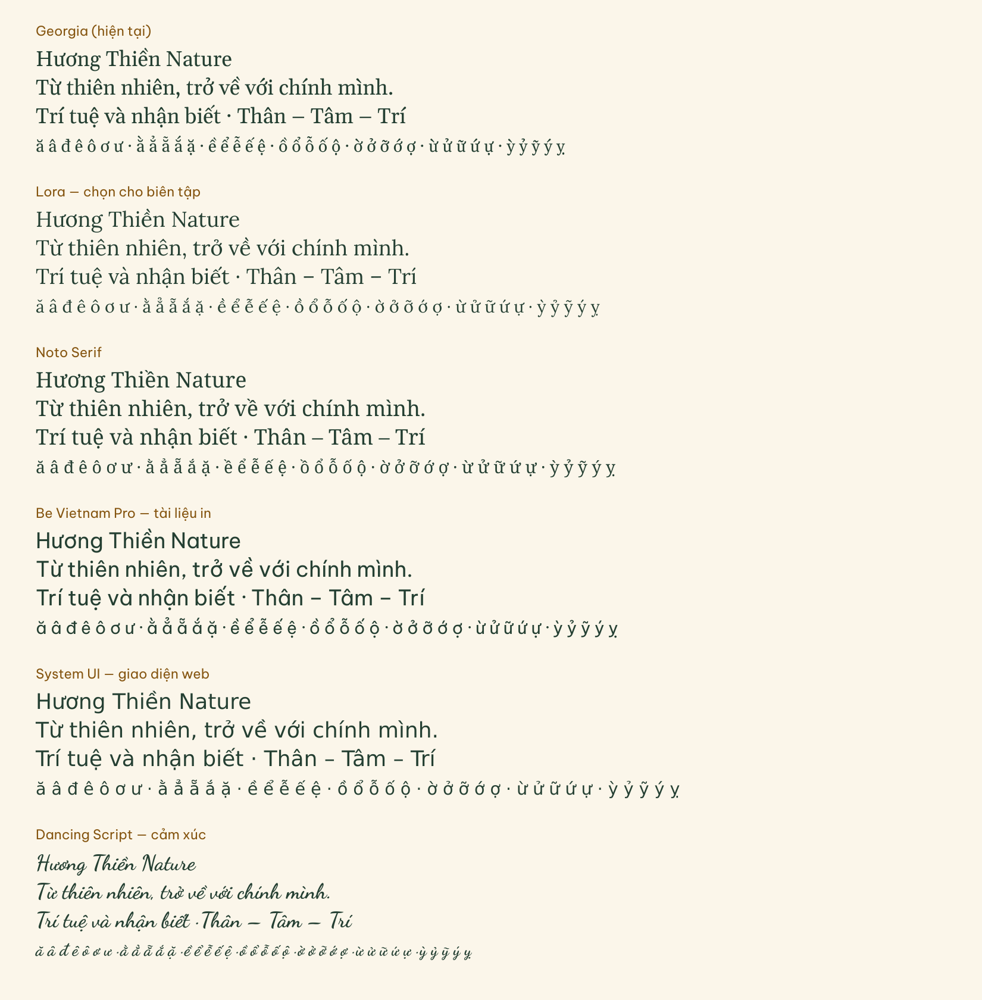

| Vai trò | Font | Dùng cho | Hạn chế |
|---|---|---|---|
| Cảm xúc | **Dancing Script** 600–700 (SIL OFL, tự lưu trữ) | Slogan, hero ngắn, lời chào, trích dẫn | Không cho văn bản dài, menu, biểu mẫu, giá, dashboard |
| Biên tập | **Lora** variable 400–700 (SIL OFL, tự lưu trữ, mới ở 2.0) | Tiêu đề, tản văn, sách, học liệu | — |
| Giao diện web | **system-ui** (Segoe UI, Roboto, SF…) | Menu, nút, biểu mẫu, văn bản giao diện | Tải tức thì, không tốn băng thông |
| Giao diện in | **Be Vietnam Pro** (SIL OFL) | Tài liệu in, mẫu mạng xã hội | — |

Đã so sánh Georgia, Lora, Noto Serif bằng văn bản tiếng Việt thật: Lora giữ dấu chồng (ề, ặ, ữ) rõ, nét ấm hợp "mộc mạc nhưng không sơ sài", file nhỏ (≈ 52 KB cho latin + vietnamese, `font-display: swap`). Tối đa **ba họ chữ** trên một trang.

### Type scale

| Cấp | Font | Cỡ (web) | Độ đậm | Line-height | Ghi chú |
|---|---|---|---|---|---|
| Display Large | Dancing Script | clamp(2.65rem, 5.5vw, 5rem) | 600 | 1.18 | Hero |
| Display Medium | Dancing Script | clamp(2.05rem, 5vw, 4rem) | 600 | 1.18 | Tiêu đề trang |
| Display Small | Dancing Script | clamp(1.9rem, 4.2vw, 3rem) | 600 | 1.2 | Tagline khối |
| Headline 1 | Lora | clamp(1.65rem, 3.3vw, 3rem) | 400 | 1.2 | letter-spacing −0,02em |
| Headline 2 | Lora | clamp(1.17rem, 2.15vw, 1.55rem) | 400–500 | 1.32 | Thẻ |
| Headline 3 / Title Large | Lora | 1.35rem | 500 | 1.3 | |
| Title Medium | system-ui | 1.05rem | 650 | 1.4 | |
| Body Large | system-ui | clamp(1.055rem, 1.5vw, 1.18rem) | 400 | 1.65 | Lead |
| Body Medium | system-ui / Lora (tản văn) | 1rem | 400 | 1.7 | Đoạn văn cách 1em |
| Body Small | system-ui | .875rem | 400 | 1.55 | |
| Label | system-ui | .875rem | 650 | 1.35 | Nút |
| Caption | system-ui | .85rem | 400 | 1.5 | |
| Quote | Lora italic | 1.2rem | 400 | 1.5 | Màu tím lan |
| Numeric | system-ui, `tabular-nums` | theo ngữ cảnh | 600 | — | Giá, số liệu |

Độ dài dòng văn bản dài: **60–75 ký tự** (token `--lz-article-measure: 68ch`). Đã kiểm ở 320 px: không cắt chữ, không chồng dấu.


# Phần 5 · Ngôn ngữ hình ảnh

## 27. Iconography

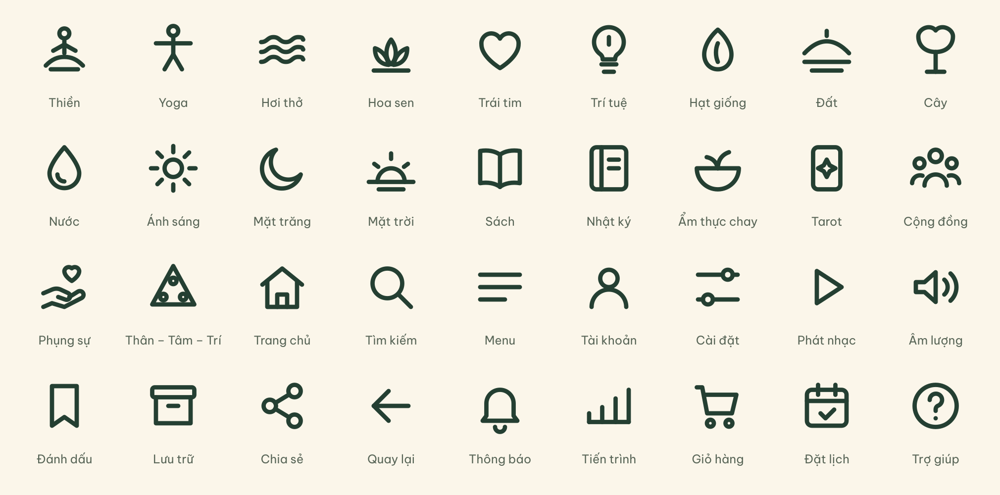

Lưới **24 × 24**, vùng sống 20 × 20 (đệm 2), nét **1,75**, đầu và góc nét tròn, không tô đặc (trừ chấm nhỏ). Hiển thị ở 20, 24, 32 px; dưới 20 px chỉ dùng icon chức năng. Bộ hiện có **20 icon thương hiệu** (thiền, yoga, hơi thở, hoa sen, trái tim, trí tuệ, hạt giống, đất, cây, nước, ánh sáng, mặt trăng, mặt trời, sách, nhật ký, ẩm thực chay, tarot, cộng đồng, phụng sự, Thân – Tâm – Trí) và **16 icon chức năng** (trang chủ, tìm kiếm, menu, tài khoản, cài đặt, phát nhạc, âm lượng, đánh dấu, lưu trữ, chia sẻ, quay lại, thông báo, tiến trình, giỏ hàng, đặt lịch, trợ giúp).
Icon chức năng phổ thông có thể thay bằng thư viện mã nguồn mở cùng phong cách (ví dụ Lucide, giấy phép ISC) nếu cần thêm. Không trộn icon 3D, emoji hệ điều hành, icon đặc và icon nét trong cùng một nhóm.

## 28. Brand patterns — Living Zen Visual Language

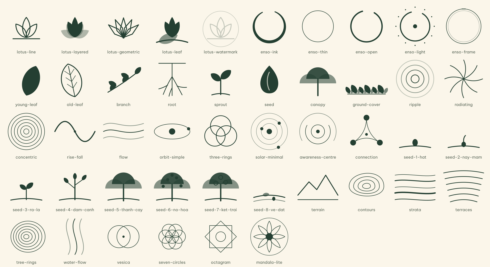

**46 họa tiết gốc** (vẽ bằng mã trong `scripts/patterns.py`, không lấy từ thương hiệu khác) trong tám nhóm:

| Nhóm | Họa tiết | Ý nghĩa sáng tạo | Dùng cho |
|---|---|---|---|
| Lotus | đơn tuyến, nhiều lớp, hình học, sen + lá, watermark | Nhận biết, trưởng thành nội tâm | Thiền, bìa, watermark |
| Ensō | nét mực, mảnh, mở, ánh sáng, khung | Khoảng lặng, tiếp nối, không hoàn hảo | Trích dẫn, khung nội dung |
| Botanical | lá non, lá già, cành, rễ, mầm, hạt, tán, thảm | Sự sống, tương thuộc | THÂN, cửa hàng, nông nghiệp |
| Breath | gợn sóng, lan tỏa, đồng tâm, lên xuống, dòng chảy | Hơi thở, thư giãn | Thực tập, thở 4s/6s |
| Orbit | quỹ đạo, ba vòng, hệ mặt trời, tâm nhận biết, kết nối | Thân – Tâm – Trí | Trang chủ, hệ sinh thái |
| Seed | 8 trạng thái: hạt → nảy mầm → ra lá → đâm cành → thành cây → nở hoa → kết trái → về đất | Nuôi dưỡng, trưởng thành | Tiến trình học, cộng đồng |
| Earth Lines | địa hình, đồng mức, tầng đất, ruộng bậc thang, vòng tuổi, dòng nước | Nguồn cội | Nông nghiệp, bao bì |
| Golden Geometry | vesica, bảy vòng tròn, bát giác, mandala giản lược | Chiêm nghiệm, ánh sáng | Tần Số Vàng (mật độ thấp) |

Không gán cho họa tiết công dụng vật lý, chữa bệnh hay năng lượng. Ensō không phải biểu tượng độc quyền; tính riêng đến từ cách vẽ và phối hợp.

Mỗi họa tiết có bản **master, đơn sắc, sáng, tối, watermark** (`patterns/<nhóm>/`). Thêm: **12 nền lặp liền mạch** (tile + bản sáng/tối), **12 khung**, **10 đường chia** (xanh và vàng), **8 nền chất liệu nhẹ**, **8 họa tiết chuyển động** (`motion/`).

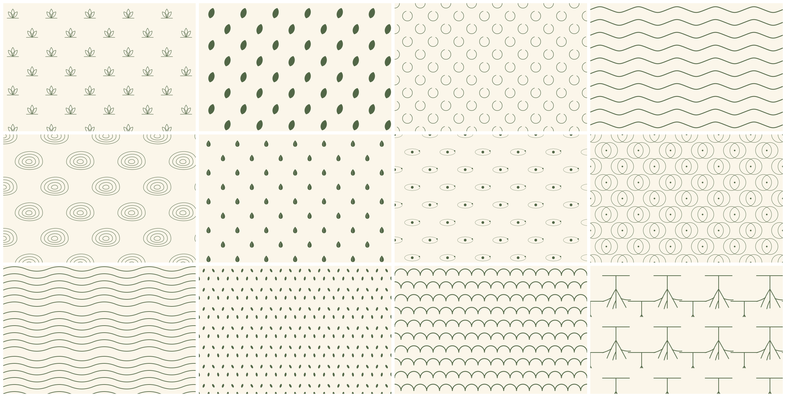

Quy tắc: tối đa **một** nền lặp mỗi màn hình, độ mờ 6–12%; không đặt họa tiết sau đoạn văn dài; website chỉ tải họa tiết đang dùng.

## 29. Photography

Ánh sáng tự nhiên, màu chân thực, chất liệu gỗ – đất – đá – giấy – nước, khoảnh khắc thực hành, con người thật, không gian giản dị. Ưu tiên ảnh thật của đội ngũ, buổi thiền, farm đối tác, sản phẩm, bữa ăn chay, thiên nhiên và cộng đồng (album hiện có 2.13.0).
Không dùng ảnh minh họa để giả mạo hoạt động, học viên hay sản phẩm thật. Ảnh có người cần sự đồng ý; ảnh có trẻ em cần sự đồng ý của người giám hộ. Ghi nguồn, giấy phép, tác giả trong `photography/README.md`.
Kỹ thuật: WebP/AVIF, cạnh dài ≤ 1280 px cho web, bỏ EXIF, `loading="lazy"` trừ ảnh đầu trang, alt mô tả điều nhìn thấy.

## 30. Illustration

Botanical line art · organic vector · watercolor nhẹ · paper texture · minimal landscape · soft geometric. Nét 2–4 px ở khung 200, đầu tròn, tối đa 2 màu + 1 nền. Mỗi chủ đề Thân – Tâm – Trí có một nhóm họa tiết gốc (Botanical/Earth · Lotus/Breath/Ensō · Orbit/Seed/Geometry). Không phụ thuộc hình ảnh AI có phong cách rời rạc; hình minh họa trong bài viết tiếp tục là SVG tự vẽ bằng mã.

## 31. Motion guidelines

Chuyển động để nâng đỡ trải nghiệm, không phải để thu hút sự chú ý bằng mọi giá.

| Token | Thời lượng | Dùng cho |
|---|---|---|
| Instant | 60 ms | Đổi trạng thái checkbox, nhấn nút |
| Fast | 150 ms | Hover, focus |
| Standard | 260 ms | Menu, tab, accordion, toast |
| Gentle | 600 ms | Khối hiện dần, dialog |
| Ambient | 4–40 s | Hơi thở (4s hít · 6s thở), quỹ đạo, hoàng hôn (22 s) |

Easing: standard `cubic-bezier(.2,.65,.3,1)`, enter `(.05,.7,.1,1)`, exit `(.3,0,.8,.15)`, breath `(.45,0,.55,1)`. Chỉ animate `opacity` và `transform`. Không nhấp nháy quá 3 lần/giây. Mọi animation tắt khi `prefers-reduced-motion: reduce`; không tự phát âm thanh; dùng CSS/SVG, không dùng SMIL hay thư viện nặng. Hình động thương hiệu: `motion/` (lá lay, hạt nảy mầm, sen nở, vòng hơi thở, gợn nước, bình minh, quỹ đạo, nét vẽ dần) và `templates/video/logo-animation.svg`.

## 32. Light/Dark themes — Nature Rhythm

| Pha | Giờ VN | Nền | Cảm giác |
|---|---|---|---|
| Dawn | 06:00–07:30 | Kem ấm pha hồng đất (`--twilight`) | Khởi đầu, sinh trưởng |
| Day | 07:30–17:00 | Giấy mộc, xanh rừng, tím lan | Sáng rõ, ổn định |
| Dusk | 17:00–18:20 | Kem ấm → hồng đất, tím lan | Buông xuống, nghỉ ngơi |
| Night | 18:20–06:00 | Tím đêm, vàng nhạt, tím lan đêm | Tĩnh lặng, riêng tư |

Người đọc chọn ở cuối trang: **Theo giờ trong ngày** (mặc định) · **Luôn sáng** · **Luôn tối** · **Theo hệ điều hành**. Lựa chọn chỉ lưu trong trình duyệt (`localStorage` khóa `htn:theme`), không cần vị trí, không gửi đi đâu. Khi đã chọn chế độ cố định, nền không tự đổi lúc đang đọc. Không có JavaScript: giao diện ban ngày, đầy đủ chức năng. Thuộc tính `html[data-phase]` (dawn/day/dusk/night) có sẵn cho các thành phần muốn đổi nhẹ theo pha.


# Phần 6 · Design System

## 33. Design tokens

Ba tầng, sinh từ một nguồn duy nhất `brand/scripts/foundation.py`:

1. **Primitive** (`tokens/primitive.json`): màu, khoảng cách 4/8/12/16/24/32/48/64/96 px, bo góc (control 10 · input 14 · card 20 · feature 28 · floating 16 · pill), font, thời lượng, easing, bóng (flat · subtle · raised · floating), breakpoint (480/768/1024/1280/1440).
2. **Semantic** (`tokens/semantic.json`): bg, surface, fg, fg-muted, primary, on-primary, secondary, accent, special, border, focus, success, warning, error, info. Trỏ về biến CSS của website nên tự đổi theo ngày/đêm.
3. **Component** (`tokens/components.json`): button (primary/secondary/special), card, input, nav, header, footer, quote, badge, progress, product card, course card, article measure.

Website dùng `src/styles/living-zen-tokens.css` (tiền tố `--lz-`), được ghi đè từ cùng script — **không sửa tay**. Quy tắc: component dùng token semantic/component, không hardcode mã màu mới.

## 34. UI components

Trang xem trước nội bộ: **`/living-zen/`** trên website (không có trong menu, `noindex`).

| Thành phần | Mặc định (ngày) | Đêm | Ghi chú truy cập |
|---|---|---|---|
| Button primary | Nền xanh rừng, chữ giấy mộc, pill, cao 48 px | Nền xanh lá nhạt, chữ xanh đậm | Focus viền 2 px; disabled mờ 55% |
| Button secondary (`button--tonal`) | Nền kem, viền cát | Nền tím xám | |
| Button special (`button--special`) | Gradient vàng, chữ mực tím | như ngày | Chỉ 1 nút đặc biệt/màn hình |
| Link | Chữ xanh rừng, gạch chân khi hover | Vàng nhạt | |
| Navigation | Mục hiện tại: nền kem + gạch 2 px xanh rừng | Gạch vàng | `aria-current="page"` |
| Card (article/course/product/profile) | Giấy nổi `#FFFDF7`, viền cát, bóng subtle, bo 20 | Tím xám đậm | Cả thẻ là một liên kết khi phù hợp |
| Quote | Lora nghiêng, tím lan, vạch trái tím nhạt | Tím lan đêm | |
| Chip / Badge | Nền kem, pill | | Không chỉ dùng màu để phân biệt |
| Form input | Viền `--border-control`, bo 14, cao ≥ 44 px | | Nhãn luôn hiện, lỗi có icon × và câu hướng dẫn |
| Toast / trạng thái | Màu ngữ nghĩa + icon ✓ ! × i | | `role="status"` |
| Progress | Rãnh kem, thanh xanh rừng | Thanh vàng | `role="progressbar"` có nhãn |
| Accordion | `<details>` gốc | | Bàn phím mặc định |
| Modal | `<dialog>` gốc | | Trả focus khi đóng |
| Empty / Loading / Error | Một câu nói thật + một hành động | | Skeleton chỉ khi tải > 300 ms |
| Footer | Xanh rừng, một đường vàng 3 px | Tím đêm | Có lựa chọn giao diện |
| Floating controls | Xanh rừng | Tím đêm + vàng | Không che CTA; vùng chạm 48 px |

Responsive đã kiểm ở 320, 360, 390, 430, 768, 1024, 1280, 1440, 1920 px.


# Phần 7 · Ứng dụng ngoài website

Mọi mẫu ở `brand/templates/`: SVG có chữ **sống** (sửa được bằng Inkscape, Figma, Illustrator…) với font Dancing Script, Lora, Be Vietnam Pro (SIL OFL, có trong `brand/fonts/`), ảnh xem trước PNG và PDF cho bản in. Chữ trong **[ngoặc vuông]** là chỗ phải thay bằng thông tin thật đã xác minh. Không mẫu nào ghi thành phần, chứng nhận, hạn dùng, giá hay công dụng thật.

## 35. Social media guidelines

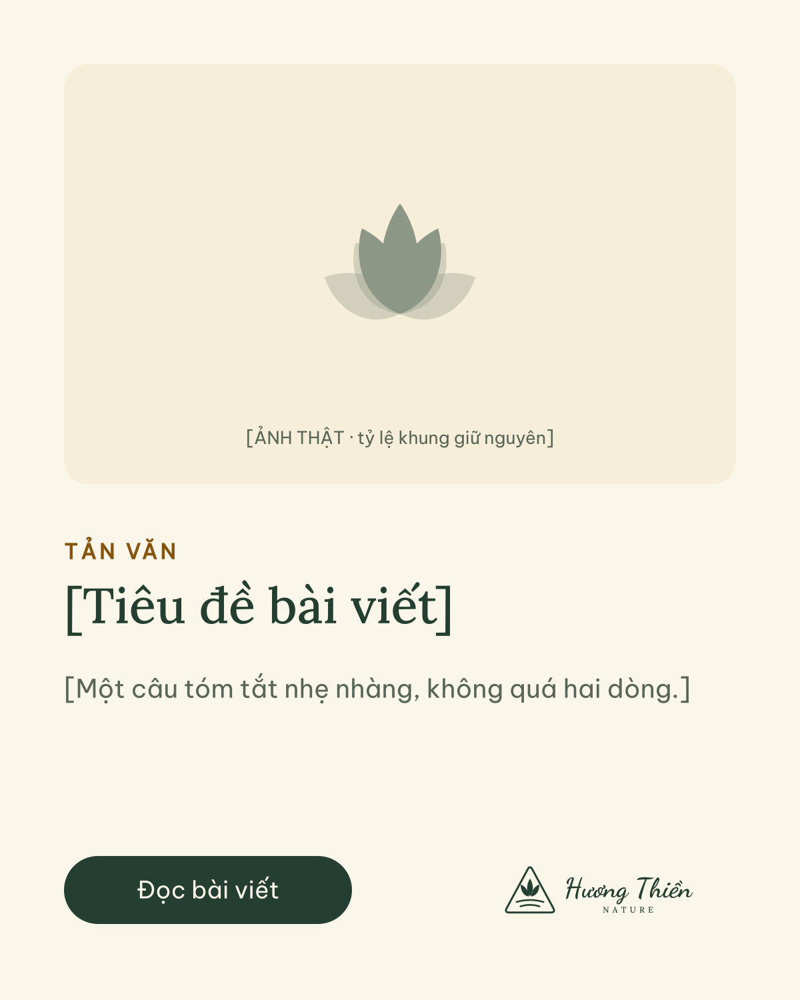{.third} 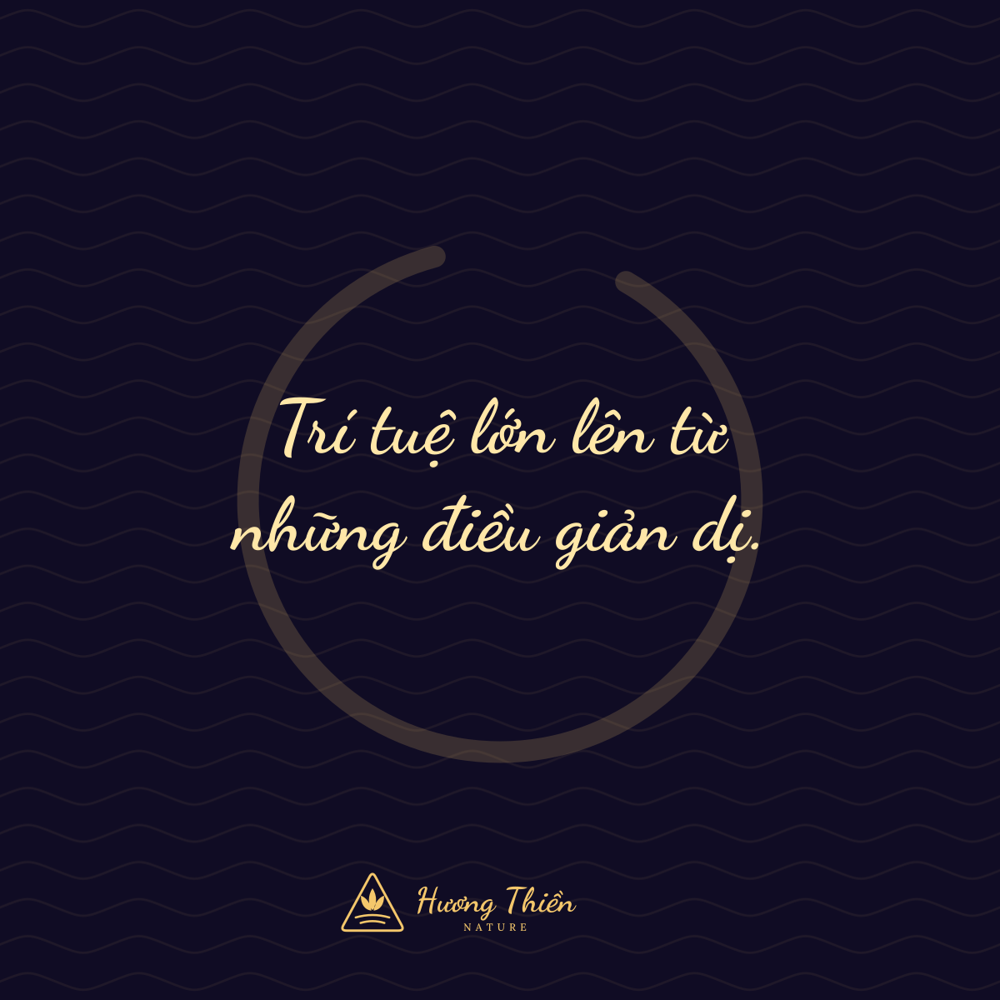{.third} 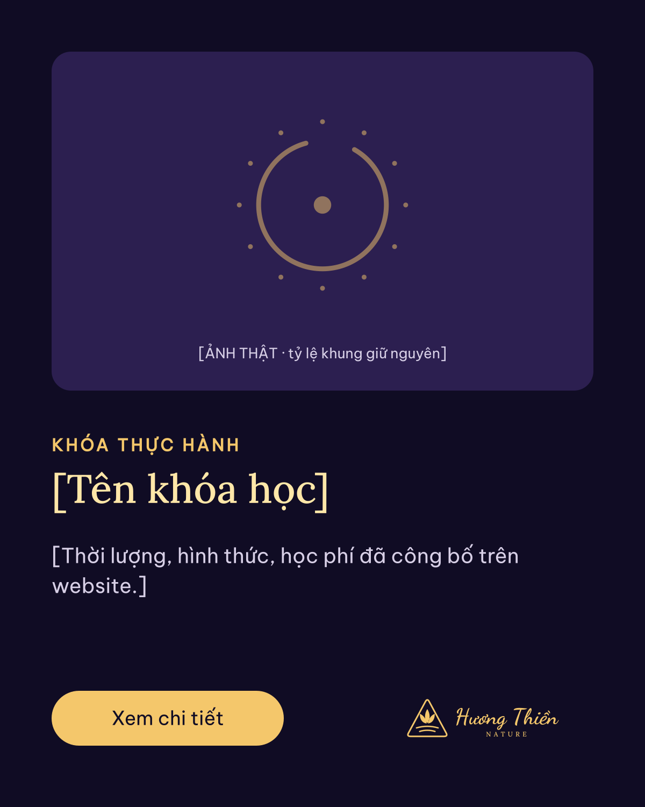{.third}

16 mẫu: avatar Facebook / Zalo / YouTube, cover Facebook (1640 × 624) / Zalo / YouTube banner (2560 × 1440, vùng an toàn 1546 × 423), thumbnail YouTube (1280 × 720), bài Instagram (1080 × 1350), story và Reel (1080 × 1920), thẻ trích dẫn sáng và tối, thông báo sự kiện, khóa học, sản phẩm, thẻ chia sẻ bài viết (1200 × 630).
Kích thước và vùng an toàn của nền tảng thay đổi theo thời gian: **kiểm tra lại hướng dẫn chính thức của từng nền tảng khi xuất bản**. Khung nét đứt trong cover là vùng an toàn, xóa trước khi đăng.
Mỗi bài: một thông điệp, một điểm nhấn màu, logo ở góc dưới; ảnh thật đặt vào khung ảnh, không kéo giãn.

## 36. Publication guidelines

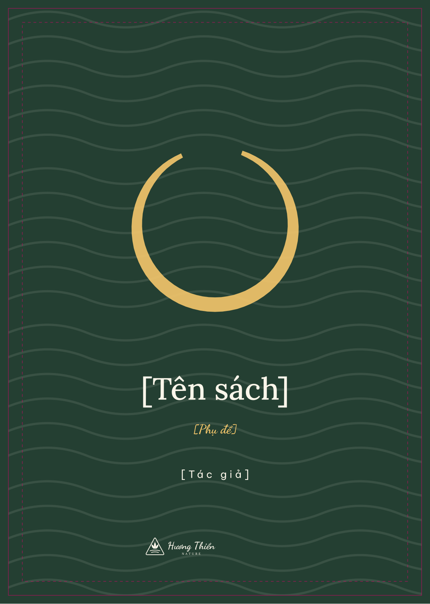{.third} 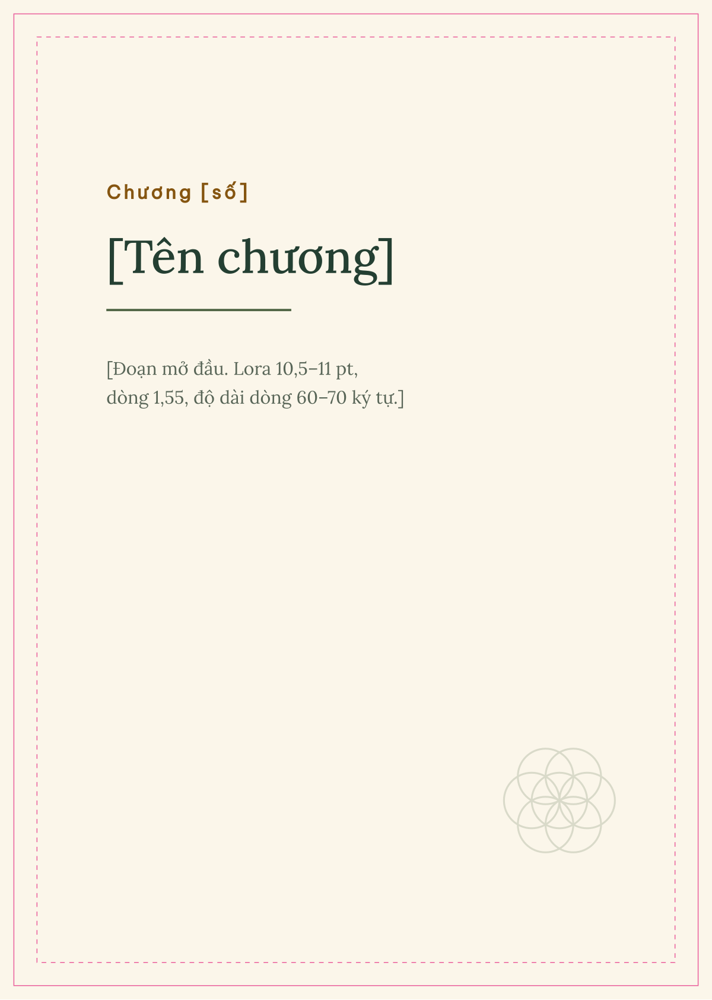{.third} 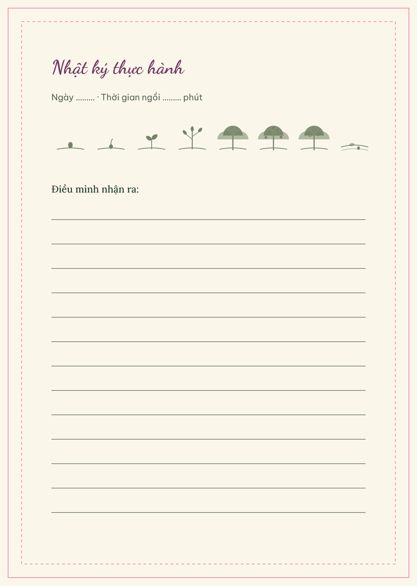{.third}

Văn phòng phẩm (8): danh thiếp 90 × 55 mm hai mặt, giấy tiêu đề A4, phong bì DL, chữ ký email HTML, thẻ cảm ơn, thẻ thông tin, thẻ QR, bìa hồ sơ giới thiệu.
Ấn phẩm (12): bìa sách A5, bìa ebook 1600 × 2560, bìa tản văn, mở chương, trang trích dẫn, mục lục, ghi chú, trang cuối, bookmark 50 × 180 mm, trang workbook A4, nhật ký thực hành A5, bìa tài liệu hướng dẫn thiền.
Giáo dục (10): 5 slide 16:9 (mở đầu, nội dung, khái niệm Thân – Tâm – Trí, trích dẫn, bài tập), phiếu thực hành, phiếu chiêm nghiệm, thẻ học tập, **giấy xác nhận tham gia** (ghi rõ: không phải chứng chỉ hay bằng cấp chuyên môn), bìa báo cáo tổng kết.
Văn bản dài: Lora 10,5–11 pt, dòng 1,5–1,6, 60–70 ký tự/dòng, lề trong ≥ 18 mm.

## 37. Packaging guidelines

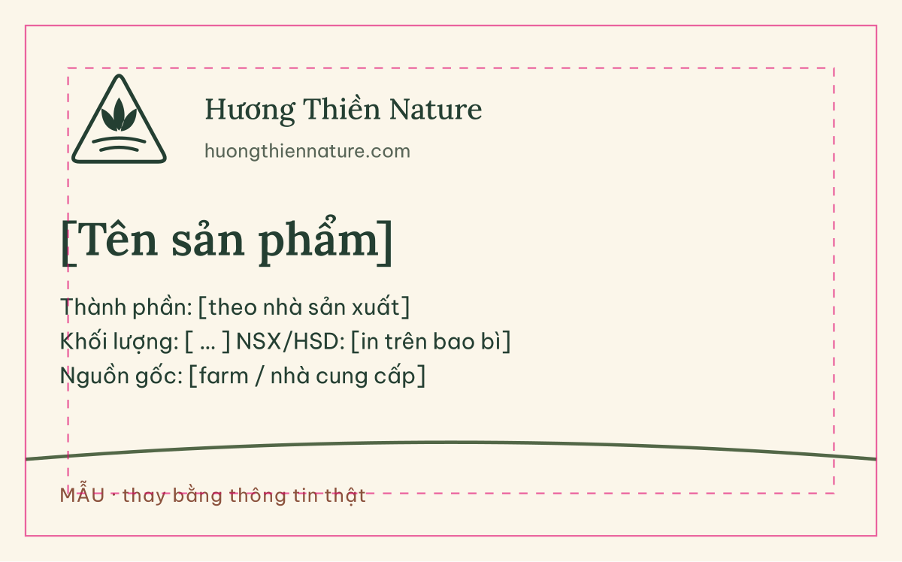{.third} 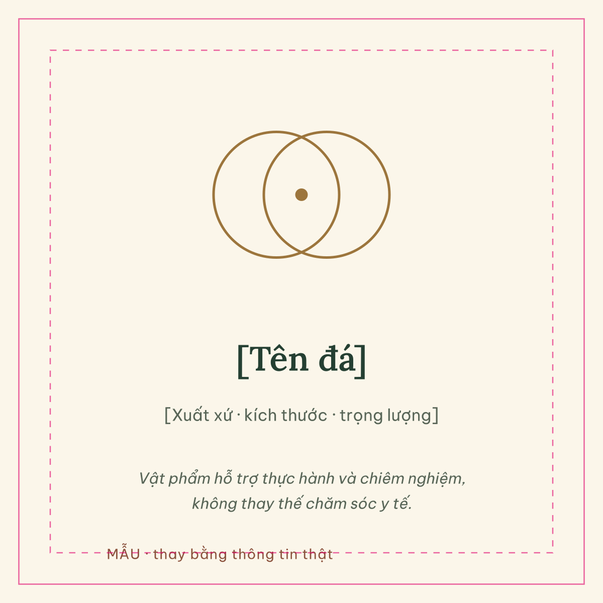{.third} 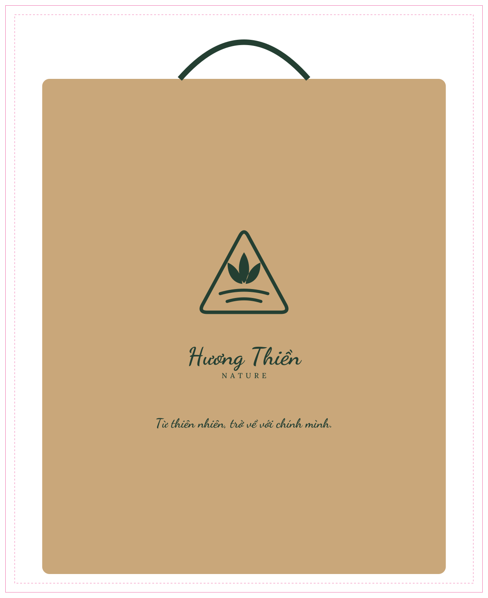{.third}

10 mẫu: tem nhãn 100 × 60 mm, nhãn chai, túi thực phẩm, hộp giấy (dieline minh họa), túi giấy, thẻ hộp đá, túi vải, thẻ nguồn gốc, thẻ bảo quản, thẻ cảm ơn khách hàng.
Mộc mạc, ít mực (ưu tiên in một màu xanh rừng trên giấy kraft), dễ tái sử dụng. Thẻ đá luôn có câu "Vật phẩm hỗ trợ thực hành và chiêm nghiệm, không thay thế chăm sóc y tế." Không tự tạo thành phần, chứng nhận hữu cơ, hạn dùng hay công dụng sức khỏe: các trường đó lấy từ nhà sản xuất và phải được kiểm tra pháp lý nhãn hàng hóa trước khi in.

## 38. Physical space identity

6 mẫu định hướng: bảng hiệu 1200 × 400 mm, bảng chào 600 × 900, biển chỉ dẫn, bảng thông tin, bảng "Cùng giữ không gian tĩnh lặng", thẻ tên. Vật liệu gợi ý: gỗ, giấy, vải, đá; khắc laser bản đơn sắc; tránh nhựa bóng và đèn LED màu. Khoảng cách đọc: chữ chính ≥ 25 mm cao cho mỗi 10 m.

## 39. Merchandise

8 mockup phẳng (chưa sản xuất): sổ tay, túi vải, áo, bưu thiếp, thiệp trích dẫn, hộp quà, bình nước, cốc gốm. Logo một màu, một câu thông điệp, ưu tiên vật liệu tự nhiên và nhà sản xuất địa phương.

### Video identity

Title card, lower third (nền trong suốt), end screen, kiểu phụ đề (Be Vietnam Pro 500, 40 px ở 1080p, nền tím đêm 72%, tối đa 2 dòng × 42 ký tự), storyboard intro/outro 4 giây và `logo-animation.svg` (CSS, 3 giây, tắt theo giảm chuyển động). Video chậm rãi, không hiệu ứng gây phân tâm; âm hiệu chỉ dùng âm thanh gốc hoặc có quyền.

## 40. Co-branding

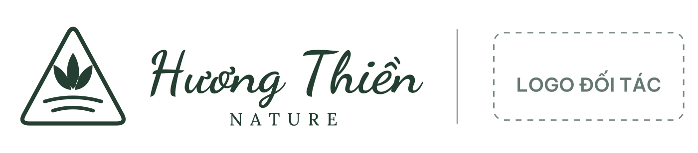

Hương Thiền Nature là **branded house**: một thương hiệu mẹ, nhiều không gian chuyên đề. Đối tác có nhận diện riêng (Farm Lê Lam Sơn, ZenWork, đối tác đá năng lượng, đơn vị giáo dục) **giữ logo của họ**; không ép dùng logo Hương Thiền Nature.

- Bố cục: logo ngang Hương Thiền Nature — đường kẻ dọc mảnh (50% độ đậm) — logo đối tác. Hai logo **cao bằng nhau về thị giác**; khoảng cách mỗi bên đường kẻ = chiều cao mark.
- Thứ tự: bên chủ trì đứng trước. Sự kiện của Hương Thiền: Hương Thiền trước; sản phẩm của farm: farm trước.
- Màu: mỗi logo giữ màu gốc; trên nền tối dùng bản đảo màu của mỗi bên.
- Câu ghi nhận: "Hương Thiền Nature × [đối tác]" hoặc "cùng đồng hành với", không dùng "được chứng nhận bởi".


# Phần 8 · Quản lý tài sản, in ấn và quản trị

## Quy chuẩn in ấn

| Hệ màu | Dùng khi | Ghi chú |
|---|---|---|
| RGB / HEX | Màn hình | Giá trị gốc ở mục 20–22 |
| CMYK | In offset/kỹ thuật số | **Chưa xác định**: phải đo theo profile màu (ví dụ FOGRA39 hoặc profile của nhà in) và in thử. Không coi giá trị CMYK hay Pantone nào là tương đương tuyệt đối với HEX khi chưa đối chiếu. |
| Grayscale | In đen trắng | Dùng logo đơn sắc đen; xanh rừng ≈ 80% đen |
| Một màu | In lụa, thêu, khắc laser, dập nổi/chìm, ép kim | Dùng `logos/monochrome/`; ép kim vàng chỉ cho brand mark, cỡ ≥ 12 mm |

Tệp in: kích thước thật, **bleed 3 mm** (đã có trong mẫu), lề an toàn 5 mm (đường nét đứt hồng trong lớp `guides`, ẩn khi in), font nhúng hợp lệ (SIL OFL cho phép nhúng) hoặc chuyển thành vector, ảnh ≥ 300 ppi ở kích thước in, PDF vector khi có thể. Thiết kế đã thử trên giấy kraft và giấy tái chế: bản một màu xanh rừng vẫn nhận diện được.

## 41. Asset management

Cấu trúc `brand/`:

```
brand/
├── README.md · CHANGELOG.md
├── audit/            báo cáo kiểm kê trước 2.0
├── strategy/         chiến lược, giọng nói, kiến trúc thương hiệu
├── guidelines/       brand book (MD + PDF), quick guide, chapters/ (nguồn)
├── logos/            legacy/ concepts/ primary/ horizontal/ vertical/ compact/ brand-mark/ wordmark/
│                     monochrome/ reversed/ favicon/ app-icons/ watermark/ co-branding/ tests/
├── colors/           palette.json · palette.svg · palette.png
├── typography/       mẫu chữ tiếng Việt, licenses/
├── fonts/            WOFF2 gốc (SIL OFL)
├── tokens/           primitive.json · semantic.json · components.json · tokens.css
├── icons/            brand/ functional/ icon-sheet
├── patterns/         8 nhóm họa tiết, seamless/ frames/ dividers/ textures/
├── motion/           8 hình động SVG
├── templates/        social-media/ stationery/ publishing/ education/ packaging/ physical-space/ merchandise/ video/
├── photography/      hướng dẫn, nguồn ảnh
├── accessibility/    tương phản, báo cáo kiểm thử
├── licenses/         tổng hợp giấy phép
├── releases/         ghi chú phát hành, hướng dẫn triển khai và khôi phục
└── scripts/          build.py · kits.py · book.py (tái tạo toàn bộ)
```

Tên tệp: `htn-<biến thể>-<màu>.<đuôi>`; họa tiết `<tên>-<master|mono|light|dark|watermark>.svg`. Website chỉ nhận những tệp đang dùng (`public/brand/`, do `build.py` chép); PDF, mockup và nguồn lớn không vào `public/`. Gói bàn giao: `releases/Huong-Thien-Nature-Living-Zen-Brand-Kit-v2.0.zip`.

## 42. Brand governance

Mỗi tài sản có: nguồn gốc (tự vẽ bằng mã / ảnh thật / thư viện + giấy phép), quyền sử dụng, trạng thái (**ĐỀ XUẤT → ĐÃ DUYỆT → NGỪNG**). Hiện tại: hệ màu, chữ, icon, họa tiết, mẫu = **ĐÃ ÁP DỤNG trên website 2.24.0**; logo Living Roots = **ĐỀ XUẤT**.

| Quy trình | Các bước |
|---|---|
| Đề xuất màu mới | Nêu mục đích + nơi dùng → kiểm tương phản (≥ 4,5:1 cho chữ) ngày và đêm → thêm vào `foundation.py` → chạy `build.py` → cập nhật mục 22 |
| Bổ sung icon | Vẽ trên lưới 24, nét 1,75 → thêm vào `icons.py` → kiểm ở 20/24/32 px → chạy `build.py` |
| Họa tiết mới | Vẽ bằng mã trong `patterns.py` → đủ 5 biến thể → ghi ý nghĩa sáng tạo (không tuyên bố công dụng) |
| Thay đổi logo | Phương án + lý do + bảng chấm điểm → chủ dự án duyệt bằng văn bản → thay tệp web, favicon, manifest, ảnh chia sẻ cùng một bản phát hành → lưu bản cũ vào `logos/legacy/` |
| Landing page mới | Dùng token và thành phần sẵn có → tối đa 1 màu không gian riêng → kiểm axe ngày/đêm, 320–1920 px |
| Đồng bộ ứng dụng (Zen Flow, Kanban, CMS…) | Dùng `tokens/tokens.css` hoặc JSON; logo theo mục 15 |
| Cập nhật Brand Book | Sửa `guidelines/chapters/*.md` → chạy `book.py` → ghi `CHANGELOG.md` |
| Quản lý phiên bản | Thương hiệu: Living Zen 2.0, 2.1… (`brand/CHANGELOG.md`). Website: số trong `package.json`. Hai hệ độc lập. |
| Kiểm tra accessibility | axe (WCAG 2.2 AA) ở chế độ ngày và đêm trước mỗi bản phát hành |
| Kiểm tra giấy phép | Ghi nguồn + giấy phép vào `licenses/README.md` trước khi dùng tài nguyên ngoài |

Không tuyên bố họa tiết, logo hay tên "Living Zen" đã được bảo hộ độc quyền về mặt pháp lý khi chưa tra cứu và đăng ký nhãn hiệu phù hợp.

## Accessibility

Mục tiêu WCAG 2.2 AA cho giao diện thuộc phạm vi: tương phản chữ 4,5:1 (chữ lớn 3:1, thành phần phi văn bản 3:1), focus nhìn thấy, bàn phím, trình đọc màn hình, giảm chuyển động, vùng chạm ≥ 44 px, không truyền tải chỉ bằng màu, zoom 200%, nhãn biểu mẫu và thông báo lỗi có hướng dẫn. Kết quả kiểm thử thật: `accessibility/README.md`.
