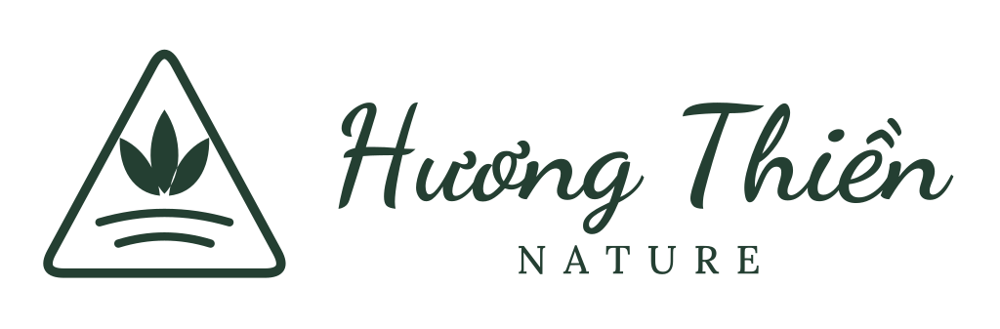
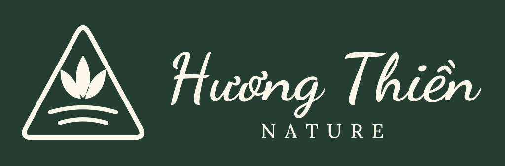
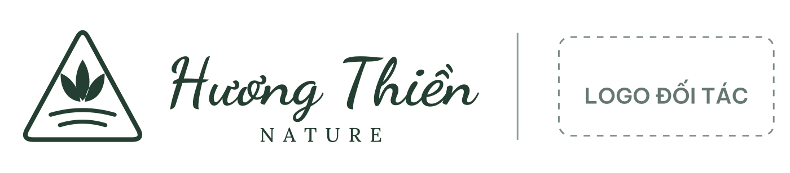

# Hương Thiền Nature · Living Zen 2.0 — Quick Guide cho đối tác

**Từ thiên nhiên, trở về với chính mình.** *Rooted in Nature. Awakened Within.*

Hương Thiền Nature là hệ sinh thái học tập, thực hành và nuôi dưỡng đời sống tỉnh thức. Ba phẩm chất: **có gốc rễ trong đất · có khoảng lặng trong tâm · có ánh sáng trong trí** (THÂN · TÂM · TRÍ).

## Logo

{.half} {.half}

- Dùng tệp trong `logos/` (SVG cho web, PDF cho in, PNG khi cần ảnh). Không vẽ lại, không kéo giãn, không thêm hiệu ứng.
- Khoảng trống quanh logo ≥ chiều cao cánh sen bên. Cỡ nhỏ nhất: horizontal 120 px / 30 mm, mark 24 px / 6 mm.
- Logo đang ở trạng thái **đề xuất** (Living Roots). Trước khi in số lượng lớn, hỏi Hương Thiền Nature bản đã duyệt.

## Màu

| Forest Green | Orchid | Golden Light | Organic Paper | Moss | Earth Clay | Night Plum |
|---|---|---|---|---|---|---|
| `#243F32` | `#713C63` | `#F4C76B` | `#FBF6EA` | `#526747` | `#8B523D` | `#100C24` |

Xanh rừng là màu chính. Vàng kim chỉ làm điểm nhấn và **không dùng cho chữ trên nền sáng**. CMYK/Pantone: đo và in thử theo nhà in, không quy đổi máy móc.

## Chữ

Dancing Script cho câu cảm xúc ngắn · Lora cho tiêu đề và văn bản · Be Vietnam Pro hoặc font hệ thống cho thông tin. Tất cả SIL OFL, có trong `fonts/`.

## Đồng thương hiệu

Logo hai bên cao bằng nhau, cách nhau bằng một đường kẻ mảnh; bên chủ trì đứng trước; mỗi bên giữ màu gốc. Ghi "Hương Thiền Nature × [đối tác]". Không dùng "được chứng nhận bởi".

## Giọng nói

Gần gũi, bao dung, chân thành. Xưng "mình / tụi mình / bạn". Không hứa chữa bệnh, không gây sợ hãi, không tạo áp lực mua. Tách bạch khoa học, giáo lý, trải nghiệm cá nhân và niềm tin. Đá và vật phẩm: "hỗ trợ thực hành và chiêm nghiệm, không thay thế chăm sóc y tế".

## Liên hệ

huongthiennature.com · Hotline/Zalo 0868 499 856
