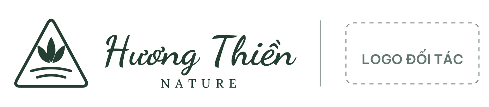

# Brand Architecture — Living Zen 2.0

Mô hình **branded house**: một thương hiệu mẹ, nhiều không gian chuyên đề có cá tính riêng. Dự án tương lai (Khu vườn nội tâm, Không gian học viên, Thư viện trí tuệ, Hệ thống thực hành miễn phí, Trợ lý học tập Bạn Đạo, Chương trình sống cộng đồng, Sách và ấn phẩm) dùng thương hiệu mẹ + một màu không gian từ bảng dưới; chức năng nghiệp vụ của các dự án này nằm ngoài phạm vi đợt nâng cấp thương hiệu.

## 24. Color combinations

| Không gian | Màu chính | Cảm giác |
|---|---|---|
| Thương hiệu mẹ | Forest + Paper + Orchid + Golden Light | Ổn định, gần gũi |
| THÂN | Moss, Forest, Earth Clay, Warm Cream | Đất, nuôi dưỡng |
| TÂM | Orchid, Orchid Mist, Deep Orchid, Paper | Riêng tư, dịu dàng |
| TRÍ | Paper, Golden Accent, Forest, Golden Light | Sáng rõ, học hỏi |
| Tần Số Vàng | Night Plum, Cosmic Plum, Golden Light, Golden Highlight | Tĩnh, sâu |
| Tarot tâm lý | Deep Orchid, Orchid, Orchid Line, Golden Light | Riêng tư, không huyền bí quá mức |
| Cửa hàng | Forest, Moss, Paper, Earth Clay | Chân thực, minh bạch |
| Quỹ & cộng đồng | Moss, Paper, Rice Gold, Golden Accent | Hợp tác, phụng sự |

## 40. Co-branding

Hương Thiền Nature là **branded house**: một thương hiệu mẹ, nhiều không gian chuyên đề. Đối tác có nhận diện riêng (Farm Lê Lam Sơn, ZenWork, đối tác đá năng lượng, đơn vị giáo dục) **giữ logo của họ**; không ép dùng logo Hương Thiền Nature.

- Bố cục: logo ngang Hương Thiền Nature — đường kẻ dọc mảnh (50% độ đậm) — logo đối tác. Hai logo **cao bằng nhau về thị giác**; khoảng cách mỗi bên đường kẻ = chiều cao mark.
- Thứ tự: bên chủ trì đứng trước. Sự kiện của Hương Thiền: Hương Thiền trước; sản phẩm của farm: farm trước.
- Màu: mỗi logo giữ màu gốc; trên nền tối dùng bản đảo màu của mỗi bên.
- Câu ghi nhận: "Hương Thiền Nature × [đối tác]" hoặc "cùng đồng hành với", không dùng "được chứng nhận bởi".
